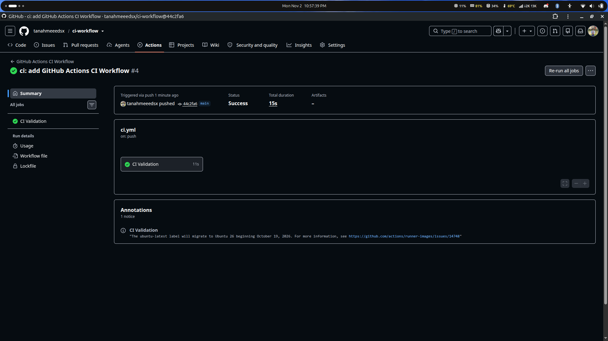

# Basic GitHub Actions CI Workflow

A beginner-friendly DevOps project demonstrating Continuous Integration (CI) with GitHub Actions. Automated validation runs when changes are pushed to `main` or a pull request targets `main`.

## Overview

This project introduces event-driven CI automation through lightweight repository checks on GitHub-hosted runners.

## What This Project Covers

- Understanding Continuous Integration fundamentals
- Creating and managing GitHub Actions workflows
- Configuring `push` and `pull_request` triggers
- Running automated shell-based validation
- Reviewing workflow jobs, steps, and execution logs

## Tech Stack

- Git and GitHub
- GitHub Actions
- YAML
- Bash

## Workflows

- `Basic CI Workflow` — `.github/workflows/ci.yml`
- `GitHub Actions CI Workflow` — `.github/workflows/github-actions-ci.yml`

Both workflows run on pushes and pull requests targeting `main`, and can also be started manually using `workflow_dispatch`.

## Validation

The workflows check Bash syntax, execute `scripts/validate.sh`, and verify that `README.md` is not empty. The validation script also checks that the expected project heading exists.

## Workflow Screenshot

The following screenshot shows a successful GitHub Actions CI workflow execution.



## Learning Outcomes

- Understand event-driven CI automation.
- Configure GitHub Actions workflow triggers.
- Execute validation commands on GitHub-hosted runners.
- Inspect CI execution results and logs.

## Repository Structure

```text
ci-workflow/
├── .github/
│   └── workflows/
│       ├── ci.yml
│       └── github-actions-ci.yml
├── scripts/
│   └── validate.sh
├── screenshots/
│   └── ci-workflow-success.png
├── README.md
└── TASK_REPORT.md
```

## Future Improvements

- Add linting and formatting checks.
- Introduce automated tests.
- Add build and artifact workflows.
- Extend the pipeline with security scanning.

## Author

[Tanjim Ahmed](https://github.com/tanahmeeedsx)
